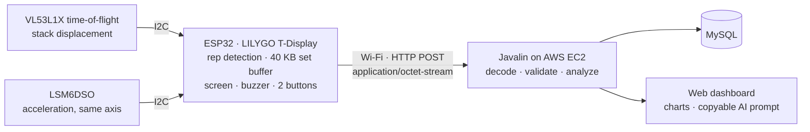

# StackSense

A low-cost IoT sensor node for pin-loaded weight-stack machines. It sits on top of the weight stack, counts reps live, and after each set uploads the raw motion data to a server that measures every rep: range of motion, concentric and eccentric time, and peak velocity.

UCI CS 147 (Internet of Things) final project · June–August 2026 · solo project by Leyang Cheng

- **Demo video:** https://youtu.be/7v7RHENa6LA
- **Final report (PDF):** https://www.xxxmnalx.com/files/stacksense-report.pdf (public copy; student ID, email and photo removed)
- **Project write-up:** https://www.xxxmnalx.com/en/work/stacksense

## Why

Beginners can't see how well they control each rep: whether the range of motion shrinks as they tire, or whether they let the weight drop on the way down. A coach can tell them, but coaching is expensive and the feedback isn't measured. StackSense records each rep so that control becomes visible.

## How it works



**On the device** (`src/main.cpp`)

- The ToF sensor faces up and measures the distance from the moving stack to the fixed panel above it; the accelerometer records acceleration on the same axis. Both share one I2C bus.
- Each set starts with a tare: a fresh distance baseline and the resting acceleration (the IMU reads about 1.03 g at rest, not 1.0 g).
- Readings are smoothed with a moving average, and velocity is estimated over a 6-point window.
- Reps are detected by an `Idle → Up → Down` state machine using peak/valley detection with hysteresis (10 mm), a minimum range of motion (50 mm) and a minimum rep time (400 ms). Each counted rep beeps and updates the screen.
- Samples go into a fixed 40 KB buffer (8,000 samples, about 150 s of data), so a whole set is uploaded once it ends.

**The upload**

Each sample is packed into 5 bytes, little-endian:

| Field | Type | Meaning |
| --- | --- | --- |
| `dt` | `uint8` | ms since the previous sample (saturates at 255) |
| `height` | `int16` | mm above the set's baseline |
| `accel` | `int16` | largest deviation from resting acceleration since the previous sample, milli-g |

When a set ends, the device sends one request:

```
POST /api/upload?set=<n>&reps=<count>&base=<baseline mm>&restg=<resting g>&n=<samples>&crc=<checksum>
Content-Type: application/octet-stream

<n × 5 bytes>
```

The server rejects the upload if the body isn't a whole number of samples, if the sample count doesn't match `n`, or if the checksum doesn't match. On any non-2xx response the device keeps the set buffered and retries every 5 s instead of losing it.

**On the server** (`server/`)

Javalin 6 on Java 17, with HikariCP and MySQL. Each set is stored with its raw packed waveform, so the server and the dashboard decode exactly what the device sent. Per-rep analysis (range of motion, concentric and eccentric time, eccentric/concentric ratio, peak velocity) is computed from that waveform.

| Method | Path | Purpose |
| --- | --- | --- |
| `GET` | `/api/health` | Health check; reports whether the database is connected |
| `POST` | `/api/upload` | Upload one completed set |
| `GET` | `/api/sets?limit=` | List recent sets |
| `GET` | `/api/sets/{id}/waveform` | Raw packed waveform for a set |
| `GET` | `/api/analysis/{id}` | Per-rep analysis for a set |
| `DELETE` | `/api/sets/{id}` | Delete a set |

The dashboard (`server/src/main/resources/public/index.html`) charts stored sets and provides a prepared analysis prompt the user can copy into their own AI chatbot.

## Results

Tested in a public gym. In a representative set of ten reps:

- 2,519 samples collected in 46.5 s (54 Hz effective sampling rate)
- 12,595 bytes uploaded in under 2 s, exactly 5 bytes per sample
- The server's own rep segmentation matched the live count shown on the device

Sensor characterization during development: the ToF reads at about 53 Hz with roughly 2 mm of noise, and just bumping the desk produces 2.5 g spikes on the IMU.

## Hardware

| Part | Qty |
| --- | --- |
| LILYGO TTGO T-Display ESP32 (1.14" TFT) | 1 |
| VL53L1X time-of-flight distance sensor | 1 |
| LSM6DSO accelerometer and gyroscope | 1 |
| Push button | 2 |
| Buzzer | 1 |
| Power supply | 1 |

Wiring (defined at the top of `src/main.cpp`):

| Signal | GPIO |
| --- | --- |
| I2C SDA (both sensors) | 21 |
| I2C SCL (both sensors) | 22 |
| Buzzer | 25 |
| Start / end button (to GND, internal pull-up) | 26 |
| Cancel button (to GND, internal pull-up) | 27 |

The start button starts a set and pressing it again ends the set; the cancel button discards a set in progress. A new set can't start while the previous one is still waiting to be sent.

> `include/cs147_pins.h` is the course's provisional pin map and is not used for this wiring.

## Build and run

**Firmware** (PlatformIO, Arduino framework)

1. Copy `include/secrets.h.example` to `include/secrets.h` (gitignored) and fill in `WIFI_SSID`, `WIFI_PASS`, `SERVER_HOST` and `SERVER_PORT`.
2. Build and flash: `pio run -t upload`
3. Serial monitor: `pio device monitor` (115200 baud)

**Server** (Java 17, Maven)

1. Create the database: `mysql -u <user> -p < server/src/main/resources/schema.sql`
2. Set `DB_URL` (for example `jdbc:mysql://localhost:3306/stacksense`), `DB_USER` and `DB_PASS`. Optionally set `STACKSENSE_PORT` (default 8080). Without database settings the server still runs but doesn't persist uploads.
3. Build and run:
   ```bash
   cd server
   mvn clean package
   java -jar target/app.jar
   ```
4. Open `http://localhost:8080/` for the dashboard.

**Deploying to EC2**

```bash
cd server
EC2_HOST=<public-ip> EC2_KEY=~/.ssh/<key>.pem ./deploy/deploy.sh
```

The script builds the jar, copies it to the instance, installs `deploy/stacksense.service` as a systemd service and checks `/api/health`. Set `EC2_USER` for non–Amazon Linux images (for example `ubuntu`). Database credentials go in `/etc/stacksense.env` on the instance. During the course the dashboard ran at https://stacksense.xxxmnalx.com; it may be offline now.

## Repository layout

```
src/main.cpp            firmware: sensors, signal processing, rep detection, upload
include/                course helper headers, secrets.h.example
platformio.ini          board, display and library configuration
server/                 Javalin server, dashboard, schema, deploy scripts
gateway/index.html      BLE probe page from the abandoned BLE design (not used)
```

## What changed along the way

- **BLE → Wi-Fi.** The first design sent data over BLE to a phone that would forward it to the cloud. nRF Connect can read BLE characteristics but can't forward data to a server, and Web Bluetooth isn't supported in Safari or Chrome on iOS, so the ESP32 now connects to Wi-Fi directly. The trade-off: changing the Wi-Fi name and password is harder for the user. `gateway/` is left over from that attempt.
- **JSON → packed binary.** A whole set as JSON didn't fit in the ESP32's RAM.
- **GET query string → POST body.** Passing samples in a query string failed for larger sets: Jetty, underneath Javalin, rejects request lines longer than its header limit before the handler runs.

## Limitations and future work

- Built for one user, one machine and one server. There are no accounts, anyone who can open the dashboard sees every set, and `DELETE /api/sets/{id}` is unauthenticated.
- Uploads use plain HTTP with no device authentication.
- Sets don't record which device sent them yet (`device_id` is a TODO in `schema.sql`).
- The ToF reading needs a diffuse surface above the sensor; a polished or angled panel, or a slight tilt, makes the signal collapse.
- The user ends each set with a button; continuous non-stop cycling isn't handled.

Planned but not built:

- Accounts with per-user data isolation and authenticated delete; TLS with a signed device token on upload.
- A new case with the ToF sensor pointing at the floor and a magnetic mount on the side of the stack.
- Server-side natural-language coaching with AWS Bedrock. It was dropped because it is billed per token on every set; the dashboard's copyable prompt is the alternative.
